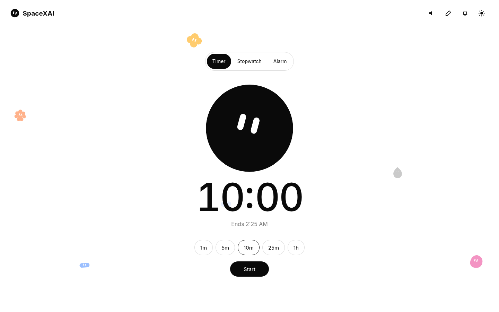

# Grok Bot Timer

A quiet full-screen timer, stopwatch, and alarm. A round Grok bot fills as time passes, sticker bots drift down behind the clock, and the hero dances when time is up.

Live app: [grok-bot-timer.vercel.app](https://grok-bot-timer.vercel.app)

Source: [github.com/shardulmarathe/grok-bot-timer](https://github.com/shardulmarathe/grok-bot-timer)

## Screenshot



## Features

- **Timer.** A scroll-wheel for hours, minutes, and seconds. The hero fills with a vivid color chosen from the bot and the background.
- **Stopwatch.** Counts up with a gentle bob, and keeps a lap list of splits and totals.
- **Alarm.** An hour, minute, and AM/PM wheel. It rings at that time, including one set for the next day.
- **Falling bots.** A light rain of flat sticker bots behind the digits.
- **Hero fill and dance.** The center bot shows progress, then dances on Time's Up.
- **Background-tab reliability.** Timing uses absolute timestamps, so a hidden tab, a locked phone, or a reload still finishes on time. The tab title, favicon, and an optional notification mark Time's Up.
- **Color picker.** Choose the hero, the fill, and the background. Choices are saved in the browser.
- **Sound toggle.** A short chime, off until you turn it on.

## Quick start

```bash
npm install
npm run dev
```

Open http://127.0.0.1:43123.

```bash
npm run build
```

The build writes a static `dist/` with relative asset paths.

```bash
npm test
```

## Project structure

```
index.html                 page shell
css/styles.css             layout and theme
css/fonts/                 Inter
js/app.js                  clock, rain, colors, persistence
js/shapes.js               bot drawing
js/time.js                 duration parsing and formatting
public/                    favicon, alert icon, manifest, home-screen icon
docs/screenshot.png        README image
tests/                     unit tests and browser checks
vite.config.js             dev server and relative build
```

## Design rules

- Eyes are white slanted pills only. No pupils, and no black eyes, in either theme.
- The hero's eyes always glide. They never snap to a new glance, including blinks, the Time's Up dance, and a tab returning.
- Digits sit in fixed slots so the clock does not shift as numbers change.
- Sound is off by default.

See [CONTRIBUTING.md](CONTRIBUTING.md) if you want to change any of this.
